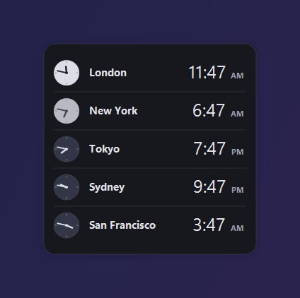
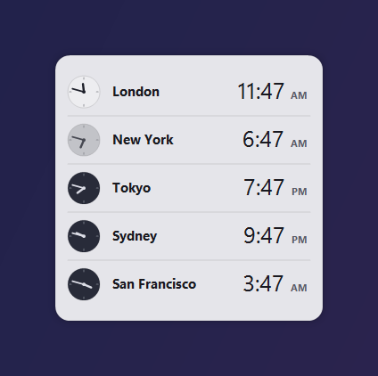
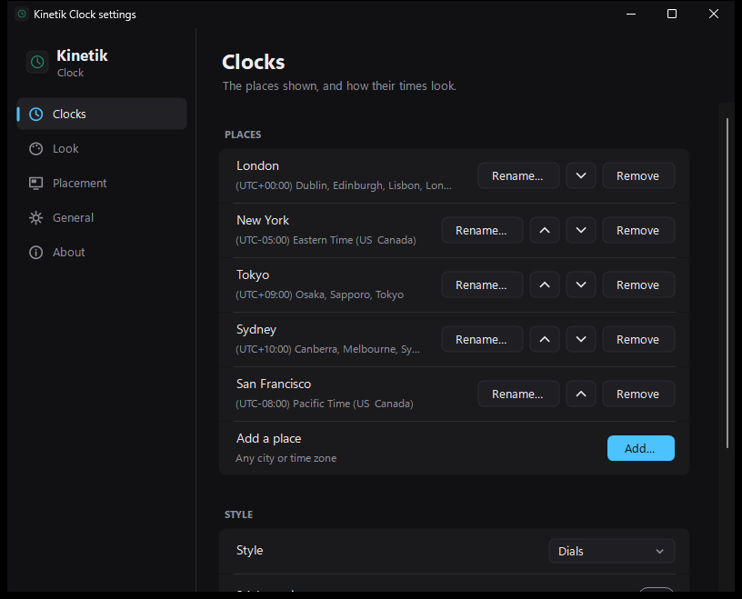
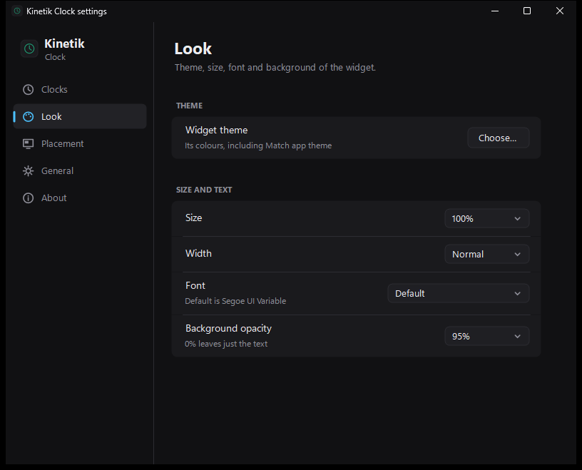

# Kinetik Clock: world clock widget for the Windows desktop

**Kinetik Clock** is a free, open-source **world clock desktop widget for Windows 11 and Windows 10**. It shows the time in as many places as you like, each with a small analog dial that turns dark at night, so you can see at a glance who's awake.

It's a small portable app with no installer and no account. It's a companion to [Kinetik Stats](https://github.com/WastedDesigner/Kinetik), the taskbar system monitor, and [Kinetik Calendar](https://github.com/WastedDesigner/KinetikCalendar), and shares their look.

  
  

> **About this project:** I made this for my own desktop and decided to share it in case anyone else finds it useful. If you run into a bug or have an idea for a feature, please [open an issue](../../issues).

## What's new in 2.0

Part of the Kinetik apps, with [Kinetik Stats](https://github.com/WastedDesigner/Kinetik) (the taskbar monitor, called just Kinetik until its v4.0), [Kinetik Hub](https://github.com/WastedDesigner/KinetikHub) and the other desktop widgets.

- **A settings window** (right-click → **Settings…**) in the style of Kinetik Stats': add, rename, reorder and remove places, choose dials or compact, 24-hour time, seconds and time differences, then Look, Placement, General and About.
- **App theme:** one theme and accent colour for every Kinetik app's windows and menus: Match Windows, Graphite, OLED black, Midnight, Nord, Mocha, Forest, Light or Paper, with a Sky, Violet, Mint, Amber, Rose or Coral accent or your Windows accent. Pick it in Settings → General, under **App theme** in the right-click menu, in Kinetik Hub or in Kinetik Stats, and every app follows.
- **Widget themes:** new **OLED black** and **Mocha**, and **Match app theme**, which uses the app theme and accent colour.
- **New icon** in the Kinetik apps' "Graphite glass" style.

## Features

- **Any number of places**, each with its own name and Windows time zone (daylight saving handled by Windows)
- **Analog dial per place** that turns dark at night
- **Themes** in the Kinetik apps' style, a choice of fonts, size and background opacity
- **Placement:** drag anywhere, snap to edges, lock position
- **Settings backup** next to the exe, offered again on a fresh Windows

## Download and use

1. Download `KinetikClock.zip` from [Releases](../../releases/latest) and extract it anywhere.
2. Run `KinetikClock.exe`. Right-click the widget for places, style, size, placement and backup.

Settings are kept in `HKCU\Software\KinetikClock`. The app makes no network connections.

## Requirements

Windows 10 or 11 (64-bit) with .NET Framework 4.8, which ships with both.

## Building from source

No SDK needed: `build.bat` compiles `KinetikClock.cs` with the .NET Framework compiler that ships with Windows. `build.bat package` also makes `KinetikClock.zip` for a release.

`KinetikClock.exe --demo` runs a separate copy with made-up places that reads and saves no settings, which is how the screenshots were made. Add `--theme Light` (or any theme name) to pick its theme.

## Tests and packaging

`python tests/run-tests.py` runs the regression checks (no window opens). `build.bat package` builds the exe and makes the release zip, checking every file in it against its SHA-256 hash. The shared support code (`SuiteSupport.cs`) is compiled into the exe, so there's no extra DLL.

## License

[GPL-3.0-or-later](LICENSE). Copyright © 2026 Akila Sella Hennedige.
